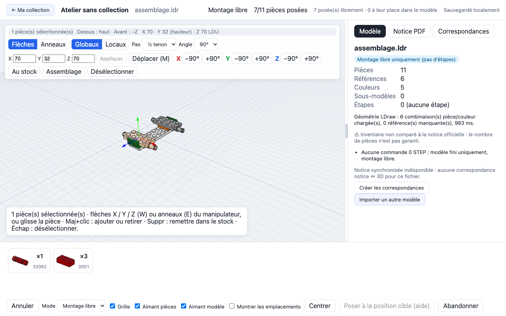

# Brick Lab Local

Application web **locale** (Mac) pour reconstruire virtuellement, pièce par pièce, des sets de briques à partir de fichiers **LDraw** (`.mpd` / `.ldr`) et de la notice PDF que tu as toi-même téléchargée.



> **Projet personnel, non affilié au groupe LEGO.** LEGO® est une marque du groupe LEGO, qui ne parraine ni n'approuve ce projet. Le dépôt ne contient **aucune** notice, aucun modèle de set tiers ni aucune bibliothèque de pièces : tout est importé localement par l'utilisateur.

## Fonctionnalités

- **Ma collection** : bibliothèque personnelle de sets et de constructions, avec progression, miniatures, sauvegarde et restauration (stockée dans `~/Documents/brick-lab-data/`).
- **Ajouter un set** : saisie d'un numéro (`31040` → `31040-1`), recherche dans tes fichiers locaux puis, sur clic uniquement, sur l'[OMR LDraw](https://library.ldraw.org/omr) ; lien vers la page officielle des notices ; métadonnées Rebrickable facultatives. Glisser-déposer de `.mpd`, `.ldr`, `.pdf` et `.brick-mapping.json` sans Internet.
- **Diagnostic de compatibilité** avant import : étapes LDraw, sous-modèles, pièces absentes de la bibliothèque locale, licence et auteur lus dans le fichier, modes de jeu réellement disponibles et pourquoi.
- **Mode guidé** : quand le fichier contient des étapes (`0 STEP`), les emplacements de l'étape s'affichent et chaque pièce s'aimante à sa cible.
- **Montage libre** : construire dans l'ordre de son choix en suivant la notice, poser où l'on pointe, rotations X/Y/Z, manipulateur 3D (flèches et anneaux), sélection et déplacement d'assemblages connectés, aimantation tenon/réceptacle et goupille/trou entre pièces.
- **Notice PDF** dans un panneau latéral redimensionnable (PDF.js), et **notice synchronisée** : éditeur de correspondances pages ↔ étapes 3D, exportable en `.brick-mapping.json`.
- **Reprise** après rechargement ou redémarrage, annulation, abandon.

## Principes

- **Local uniquement** : le serveur écoute sur `127.0.0.1`, télémétrie Next.js désactivée, aucun compte, aucune analytics, aucun stockage cloud.
- **Réseau minimal et explicite** : seules les actions « Chercher en ligne » et « Télécharger » contactent l'OMR (et Rebrickable si une clé est configurée), avec liste d'hôtes autorisés, tailles et délais bornés. `BRICK_LAB_ONLINE=0` coupe tout accès réseau. Les notices LEGO ne sont jamais téléchargées automatiquement.
- **Fichiers non fiables** : parsing borné (taille, profondeur, cycles, chemins `../`, noms dupliqués, références absentes).
- **Honnêteté sur les limites** : un modèle est signalé incomplet ou sans étapes plutôt que présenté comme jouable.

## Prérequis

- macOS, **Node.js ≥ 20.9** (testé avec 24.5) et npm.
- La **bibliothèque de pièces LDraw** (gratuite, CC BY 4.0), à télécharger une fois et à conserver hors du dépôt.

## Installation

```bash
git clone https://github.com/Pierson38/brick-build.git
```

```bash
cd brick-build && npm ci
```

1. Télécharge [`complete.zip`](https://library.ldraw.org/library/updates/complete.zip) depuis la bibliothèque LDraw et décompresse-le, par exemple dans `~/Documents/brick-lab-data/ldraw/`.
2. Crée un fichier `.env.local` à la racine du projet :

   ```dotenv
   LDRAW_LIBRARY_DIR=/Users/<toi>/Documents/brick-lab-data/ldraw

   # Facultatif
   # BRICK_LAB_DATA_DIR=/chemin/vers/mes/donnees   # défaut : ~/Documents/brick-lab-data
   # REBRICKABLE_API_KEY=<clé personnelle>          # nom, année et nombre de pièces annoncé
   # BRICK_LAB_ONLINE=0                             # interdit tout accès Internet
   ```

3. Vérifie la bibliothèque :

   ```bash
   npm run check:ldraw
   ```

## Lancement

```bash
npm run dev
```

Puis ouvre <http://127.0.0.1:3000>. Pour un usage quotidien plus fluide, utilise le build de production :

```bash
npm run build && npm start
```

Pages principales : `/` (Ma collection), `/ajouter` (ajouter un set), `/atelier` (atelier sans collection, pour essayer un fichier).

Pour un premier essai sans rien télécharger d'autre que la bibliothèque de pièces, ouvre `/atelier` et importe `fixtures/mini-4-pieces.mpd`.

## Tests

```bash
npx playwright install chromium
```

```bash
npm run recette
```

`recette` enchaîne le contrôle du manifeste de spécification, `tsc --noEmit`, Vitest et Playwright. Les suites E2E démarrent leur propre serveur sur un dossier temporaire : arrête `npm run dev` avant de les lancer.

| Commande | Rôle |
|---|---|
| `npm run typecheck` | TypeScript strict |
| `npm test` | Tests unitaires (parseur, moteur, connexions, bibliothèque, import) |
| `npm run test:e2e` | Parcours Playwright sur fixtures synthétiques |
| `npm run perf` | Mesures sur build de production |
| `npm run compat-report -- <fichier.mpd>` | Rapport de compatibilité d'un modèle |

Les tests sur sets réels (`*-omr.spec.ts`, `tests/recette/`) lisent des fichiers placés dans `~/Documents/brick-lab-data/` (ou `$BRICK_LAB_DATA`) et sont ignorés quand ils sont absents.

## Stack

Next.js (App Router) · React · TypeScript strict · Three.js + `@react-three/fiber` / `drei` (`LDrawLoader`) · PDF.js · Vitest · Playwright.

```text
src/
  app/          pages et routes API locales
  components/   atelier, collection, import, PDF, scène 3D
  domain/       parseur LDraw, moteur de construction, connexions, import (sans Three.js)
  infra/        accès à la bibliothèque LDraw, persistance, miniatures
  server/       bibliothèque personnelle, accès réseau encadré, sources en ligne
fixtures/       petits modèles LDraw originaux (CC0)
tests/          unitaires, E2E, performance, recettes réelles
docs/           spécification et notes d'implémentation
```

## Documentation

- [`docs/01` à `docs/09`](docs/) : spécification initiale v1.0 (produit, architecture, LDraw, UX, plan, tests, droits, schéma de données, risques), figée et contrôlée par `npm run check:spec`.
- [`docs/implementation/`](docs/implementation/README.md) : notes de lots, journal des décisions, écarts, rapports de recette et captures.
- [`CLAUDE.md`](CLAUDE.md) et [`PROMPT_CLAUDE_CODE.md`](PROMPT_CLAUDE_CODE.md) : consignes de développement (le projet est développé avec Claude Code).

## Limites connues

- Tous les sets ne sont pas jouables : cela dépend de la qualité du fichier LDraw (étapes, sous-modèles, pièces disponibles).
- L'inventaire d'un fichier OMR n'est pas garanti identique à celui de la boîte.
- Aucune conversion automatique d'une notice PDF en données 3D : la synchronisation notice ↔ 3D repose sur des correspondances saisies.
- L'aimantation reconnaît tenons, réceptacles, goupilles et trous de goupille ; axes, clips, barres et charnières ne le sont pas encore.
- Testé sur macOS avec Chromium et WebKit uniquement.

## Contenus tiers et droits

- La **bibliothèque de pièces LDraw** et les **modèles de l'OMR** sont des contributions communautaires sous leurs propres licences (CC BY 2.0/4.0 selon les fichiers) ; l'application lit et affiche la licence déclarée dans chaque fichier.
- Les **notices** sont protégées par le droit d'auteur : télécharge-les toi-même sur le site officiel, pour ton usage personnel, et ne les redistribue pas.
- Ne commite jamais de notice, de modèle de set tiers ou de bibliothèque de pièces dans ce dépôt (`.gitignore` exclut `local-models/`, `local-instructions/`, `local-ldraw-library/`).

Détails : [`docs/07_DROITS_ET_SOURCES.md`](docs/07_DROITS_ET_SOURCES.md). Ce document n'est pas un avis juridique.

## Licence

Aucune licence n'est encore attachée au code : sauf mention contraire, tous droits réservés. Les fixtures de `fixtures/` et `tests/fixtures/` sont des créations originales sous CC0-1.0.

La version d'origine de ce README (dossier de spécification v1.0) reste consultable dans le commit `b019989` (`git show b019989:README.md`).
