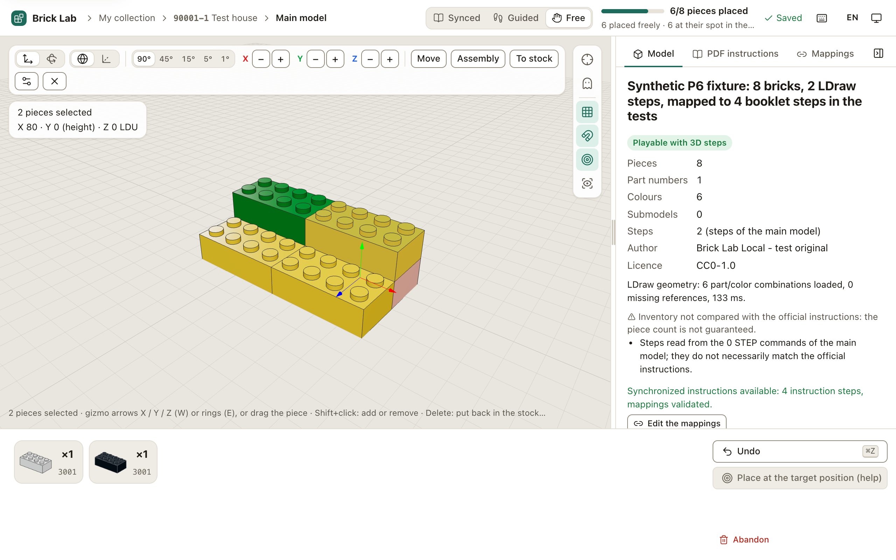

# Brick Lab Local — LDraw viewer and virtual brick builder

[](https://github.com/Pierson38/brick-lab-ldraw/actions/workflows/ci.yml) [](LICENSE) [](https://pierson38.github.io/brick-lab-ldraw/)

**Brick Lab Local** is a free, open-source, **local-first** web app (macOS; Windows in preview) to rebuild brick sets virtually, part by part, in 3D. Open an **LDraw** model (`.mpd` / `.ldr`, for example from the LDraw OMR), follow its building steps in guided mode or build freely with stud snapping, and read the PDF instructions you downloaded yourself side by side. No account, no cloud: everything stays on your computer.

*Français : Brick Lab Local est une application libre pour reconstruire virtuellement des sets de briques en 3D, étape par étape, à partir de fichiers LDraw et de vos notices PDF. L'interface est disponible en français.*



> **Personal project, not affiliated with the LEGO Group.** LEGO® is a trademark of the LEGO Group, which does not sponsor or endorse this project. The repository contains **no** instructions, no third-party set models and no parts library: everything is imported locally by the user.
>
> The interface is available in French and English (FR/EN switch in the top bar); the documentation is in English.

## Features

- **My collection** ("Ma collection"): a personal library of sets and builds, with progress, thumbnails, backup and restore (stored in `~/Documents/brick-lab-data/`, or `%USERPROFILE%\brick-lab-data\` on Windows).
- **Add a set**: type a set number (`31040` → `31040-1`), search your local files and then, only when you click, the [LDraw OMR](https://library.ldraw.org/omr); link to the official instructions page; optional Rebrickable metadata. Drag and drop `.mpd`, `.ldr`, `.pdf` and `.brick-mapping.json` files without Internet access.
- **Compatibility check** before import: LDraw steps, submodels, parts missing from the local library, license and author read from the file, which play modes are actually available and why.
- **Guided mode**: when the file contains steps (`0 STEP`), the step's target positions are shown and each part snaps to its target. The part in hand can be rotated around X, Y and Z.
- **Free building**: build in any order while following the instructions, place parts where you point, X/Y/Z rotations down to the degree, 3D manipulator (arrows and rings), selection and moving of connected assemblies (Shift + double-click adds another assembly), stud/anti-stud and pin/pin-hole snapping between parts.
- **PDF instructions** in a resizable side panel (PDF.js), and **synchronized instructions**: an editor mapping instruction pages ↔ 3D steps, exportable as `.brick-mapping.json`.
- **Resume** after reload or restart, undo, abandon.
- French and English interface, light and dark themes.

## Principles

- **Local only**: the server listens on `127.0.0.1`, Next.js telemetry is disabled, no account, no analytics, no cloud storage.
- **Minimal, explicit networking**: only the "Search online" and "Download" actions contact the OMR (and Rebrickable if a key is configured), with an allowlist of hosts and bounded sizes and timeouts. `BRICK_LAB_ONLINE=0` disables all network access. LEGO instructions are never downloaded automatically.
- **Untrusted files**: bounded parsing (size, depth, cycles, `../` paths, duplicate names, missing references).
- **Honest about limits**: a model is flagged as incomplete or step-less rather than presented as playable.

## Requirements

- macOS, or Windows 10/11 (preview, see [Windows](#windows-preview)).
- **Node.js ≥ 20.9** (tested with 24.5) and npm; **Git** (on Windows: Git for Windows).
- The **LDraw parts library** (free, CC BY 4.0), downloaded once and kept outside the repository.

## Installation

### 1. Code and dependencies

```bash
git clone https://github.com/Pierson38/brick-lab-ldraw.git
```

```bash
cd brick-lab-ldraw
```

```bash
npm ci
```

### 2. LDraw parts library

Download [`complete.zip`](https://library.ldraw.org/library/updates/complete.zip) and unzip it into your data folder; it contains an `ldraw/` folder.

| | Default data folder | LDraw library |
|---|---|---|
| macOS | `~/Documents/brick-lab-data` | `~/Documents/brick-lab-data/ldraw` |
| Windows | `%USERPROFILE%\brick-lab-data` | `%USERPROFILE%\brick-lab-data\ldraw` |

On Windows, in PowerShell:

```powershell
Expand-Archive "$HOME\Downloads\complete.zip" -DestinationPath "$HOME\brick-lab-data"
```

### 3. `.env.local` file

At the project root, it tells the app where the LDraw library is. macOS:

```bash
printf 'LDRAW_LIBRARY_DIR=%s/Documents/brick-lab-data/ldraw\n' "$HOME" > .env.local
```

Windows (PowerShell; writes the path with `/` and as UTF-8 without BOM):

```powershell
[IO.File]::WriteAllText("$PWD\.env.local", "LDRAW_LIBRARY_DIR=$($HOME -replace '\\', '/')/brick-lab-data/ldraw`n")
```

If you write it by hand, save it as **UTF-8 without BOM** under the exact name `.env.local` (Notepad may append `.txt`). Optional settings:

```dotenv
# BRICK_LAB_DATA_DIR=/path/to/my/data   # another data folder (avoid a folder synced by OneDrive/iCloud)
# REBRICKABLE_API_KEY=<personal key>     # name, year and announced part count
# BRICK_LAB_ONLINE=0                     # forbids any Internet access
```

### 4. Check

```bash
npm run check:ldraw
```

## Running

```bash
npm run dev
```

Then open <http://127.0.0.1:3000>. For smoother everyday use, run the production build, in two commands (Windows PowerShell 5.1 does not support `&&`):

```bash
npm run build
```

```bash
npm start
```

Main pages: `/` (My collection), `/ajouter` (add a set), `/atelier` (standalone workshop, to try a file without adding it to the collection).

For a first try without downloading anything but the parts library, open `/atelier` and import `fixtures/mini-4-pieces.mpd`.

## Tests

```bash
npx playwright install chromium
```

```bash
npm run recette
```

`recette` (acceptance) runs the specification manifest check, `tsc --noEmit`, Vitest and Playwright in sequence. The E2E suites start their own server on a temporary folder and on port 3000: stop `npm run dev` (and any other server on that port) before running them, otherwise they would reuse it.

| Command | Purpose |
|---|---|
| `npm run typecheck` | Strict TypeScript |
| `npm test` | Unit tests (parser, engine, connections, library, import, Windows portability) |
| `npm run test:e2e` | Playwright journeys on synthetic fixtures |
| `npm run perf` | Measurements on a production build |
| `npm run compat-report -- <file.mpd>` | Compatibility report for a model |

Tests on real sets (`*-omr.spec.ts`, `tests/recette/`) read files placed in the default data folder (or in the `BRICK_LAB_DATA` environment variable) and are skipped when those files are absent.

## Stack

Next.js (App Router) · React · strict TypeScript · Three.js + `@react-three/fiber` / `drei` (`LDrawLoader`) · PDF.js · Vitest · Playwright.

```text
src/
  app/          pages and local API routes
  components/   workshop, collection, import, PDF, 3D scene
  domain/       LDraw parser, build engine, connections, import (no Three.js)
  infra/        LDraw library access, persistence, thumbnails
  server/       personal library, guarded network access, online sources
fixtures/       small original LDraw models (CC0)
tests/          unit, E2E, performance, real-set acceptance tests
docs/           specification and implementation notes
site/           static presentation page published on GitHub Pages (not the app)
```

## Documentation

- [`docs/01` to `docs/09`](docs/): initial v1.0 specification (product, architecture, LDraw, UX, plan, tests, rights, data schema, risks), frozen and checked by `npm run check:spec`. File names are kept in French so the manifest stays traceable.
- [`docs/implementation/`](docs/implementation/README.md): batch notes, decision log, deviations, acceptance reports and screenshots.
- [`REFONTE/`](REFONTE/rapport.md): UI redesign report, with before/after screenshots.
- [`CLAUDE.md`](CLAUDE.md) and [`PROMPT_CLAUDE_CODE.md`](PROMPT_CLAUDE_CODE.md): development guidelines (the project is developed with Claude Code).

## Known limitations

- Not every set is playable: it depends on the quality of the LDraw file (steps, submodels, available parts).
- The inventory of an OMR file is not guaranteed to match the one in the box.
- No automatic conversion of PDF instructions into 3D data: instructions ↔ 3D synchronization relies on manually entered mappings.
- Snapping recognizes studs, anti-studs, pins and pin holes; axles, clips, bars and hinges are not supported yet.
- Tested on macOS with Chromium and WebKit. Windows support is a **preview**: see below.

## Windows (preview)

The npm commands are the same as on Mac, in PowerShell or the command prompt: npm and Playwright scripts go through `scripts/run-next.mjs` and no longer use macOS/Linux-specific syntax. What changes on Windows:

- **Data folder**: `%USERPROFILE%\brick-lab-data` by default, not `Documents`, which is often moved into OneDrive, whose syncing locks files. Also avoid a synced folder for `BRICK_LAB_DATA_DIR`.
- **File names**: names reserved by Windows (`con`, `nul`, `com1`…, even with an extension) and names ending with a dot or a space are rejected.
- **Line endings**: `.gitattributes` enforces LF regardless of `core.autocrlf`; otherwise `npm run check:spec` would fail.
- **Writes**: a rename briefly blocked by an antivirus, the indexer or OneDrive is retried; on a disk without hard links (FAT/exFAT), files are copied then renamed.
- **Permissions**: library files inherit the permissions of the profile folder (the macOS `600` mode does not exist on Windows).

The unit tests run on Windows in CI; **the app itself has not yet been run on a real Windows machine**. Feedback is welcome.

## Third-party content and rights

- The **LDraw parts library** and **OMR models** are community contributions under their own licenses (CC BY 2.0/4.0 depending on the file); the app reads and displays the license declared in each file.
- **Instructions** are protected by copyright: download them yourself from the official website, for your personal use, and do not redistribute them.
- Never commit instructions, third-party set models or a parts library to this repository (`.gitignore` excludes `local-models/`, `local-instructions/`, `local-ldraw-library/`).

Details: [`docs/07_DROITS_ET_SOURCES.md`](docs/07_DROITS_ET_SOURCES.md). This document is not legal advice.

## Contributing

Issues and pull requests are welcome: read [`CONTRIBUTING.md`](CONTRIBUTING.md) first (golden rule: no third-party content in the repository, issues or PRs). Report security vulnerabilities privately, see [`SECURITY.md`](SECURITY.md). Interactions follow the [code of conduct](CODE_OF_CONDUCT.md).

## License

Code under the [MIT](LICENSE) license. The fixtures in `fixtures/` and `tests/fixtures/` are original works under CC0-1.0.

The MIT license covers only the code and documentation of this repository. It does not extend to the LDraw parts library, OMR models, or LEGO instructions or trademarks, which remain subject to their own terms.

The original version of this README (v1.0 specification dossier, in French) is still available in commit `b019989` (`git show b019989:README.md`).
